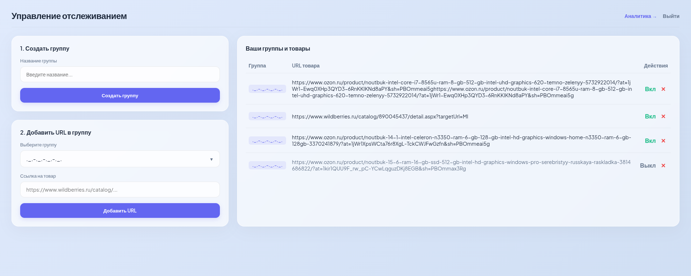
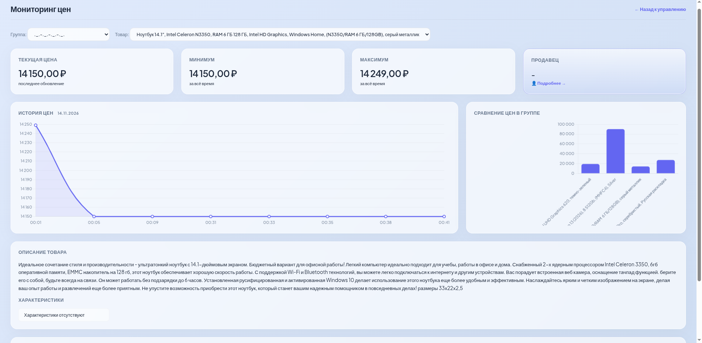

goprxveil

Purpose: Software for automated monitoring, collection and analysis of prices for marketplace products (Ozon, Wildberries).


_Managing the list of tracked URLs and product groups_

_Visualization of price history and product statistics_

```
For a quick local start
git clone https://github.com/Miroku777/goprxveil.git
cd goprxveil
Create it .env file (example in section 4)
make migrate-up
make run
```

### 1. Program description
The program is a web service consisting of a parser (scraper) and an analytics panel. It provides background price updates at specified URLs and provides an interface for visualizing price history, tracking minimum/maximum values, and obtaining seller data.

### 2. Functional features
Parsing Ozon product cards (via Playwright) with anti-bot protection (Variti) bypass. Parsing Wildberries product cards (via go-rod). Storing price change history in a relational database (PostgreSQL). A web interface for viewing price charts (Chart.js) and statistics. JWT-based user authorization. Support for deployment via Docker and Docker Compose.

### 3. System requirements
Programming language: Go 1.27+
DBMS: PostgreSQL 16+
Browser runtime: Chromium / Google Chrome, Node.js (for Playwright)
Containerization: Docker, Docker Compose
Utilities: git, as well as make and Linux (for local startup)

### 4. Installation and launch (Docker)
The deployment is done using Docker Compose.

1. Create a file .env in the root directory of the project and set the variables:
`DB_USER=prxveil`
`DB_PASSWORD=password`
`DB_NAME=prxveil_db`
2. Build and launch containers:
`docker compose up -d --build`
The service will be available at http://localhost:8888 . The pgAdmin panel is available on port 5050.
(in case of errors, it is recommended to run the application locally section 5)

### 5. Installation and Launch (Locally)
1. Install Go Dependencies:
`go mod download`
2. Install drivers for Playwright and browser dependencies:
`go run github.com/mxschmitt/playwright-go/cmd/playwright@v0.6401.0 install --with-deps`
3. Apply database migrations:
`migrate-up | migrate-down`
4. Launch the app:
`make run`

### 6. Environment variables .env

| Variable | Description | Example |
| :--- | :---: | ---: |               	                      
| DB_USER | username PostgreSQL	| prxveil |
| DB_PASSWORD | user password PostgreSQL | secret
| DB_NAME | Database name | prxveil_db |
| DB_HOST | Database Host | localhost (or postgres in Docker) |


### 7. Project structure
```
.
├── cmd
│   └── app
│       └── main.go             # Application Entry point
├── internal
│   ├── api                     # Routing HTTP
│   ├── browser                 # Browser initialization (rod, playwright)
│   ├── config                  # Configuration (database, environment variables)
│   ├── handlers                # HTTP-handlers (login, dashboard, analytics)
│   ├── middleware              # JWT-authorization and logging
│   ├── models                  # Data structures (DB entities, API responses)
│   ├── parser                  # Marketplace Parsers (Ozon, WB)
│   └── storage                 # Working with databases (SQL queries)
├── migrations                  # SQL scripts for creating tables
├── templates                   # Web interface (HTML, CSS, JS)
├── Dockerfile                  # Building a Docker image
├── docker-compose.yml          # Container orchestration (app, db, pgadmin)
└── Makefile                    # Commands for local build and launch
```

### 8. Features of operation
When you first start parsing Ozon, a captcha (Variti protection) may appear. For stable operation, it is required to be checked once in the visible window mode (locally), after which cookies are saved in the ~/.ozon-mcp-userdata directory (or in the ozon_data Docker volume).

_Note: Scraping may violate the terms of use of the websites. Use this tool responsibly._